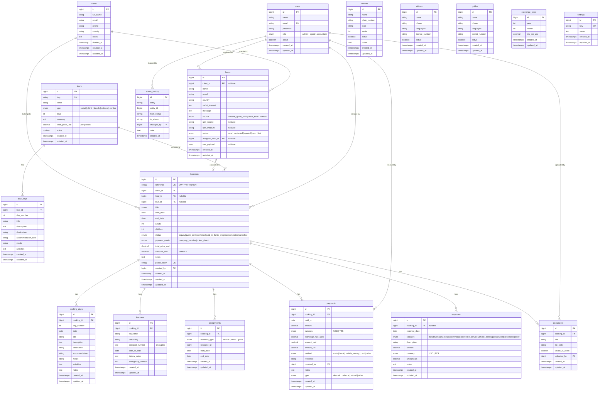

# Uhalisia wa Tanzania — Portal Implementation Plan

## 0. Environment & Technology Decisions

| Item | Value |
|---|---|
| PHP Version (detected) | **8.2.12** (ZTS, CLI) |
| MariaDB Version | **10.4.32** |
| Laravel Version | **11.x** (latest LTS-class release that requires PHP ≥ 8.2) |
| Frontend | Blade + Bootstrap 5.3.3 + Bootstrap Icons 1.11 (locally bundled) |
| Fonts | Merriweather (headings) + Inter (body), self-hosted WOFF2 |
| PDF | `barryvdh/laravel-dompdf` (free) |
| Excel/CSV | `phpoffice/phpspreadsheet` (free) |
| Charts | Chart.js 4.x (locally bundled JS) |
| Alpine.js | 3.x (locally bundled) for drag-to-reorder, dropdowns, toggling |
| Mail | SMTP via `.env`; development mode → `log` driver |

> [!IMPORTANT]
> **Laravel 12** requires PHP ≥ 8.2 but was released Feb 2025 and is still young. **Laravel 11** is the more battle-tested choice for PHP 8.2, has LTS-length support until 2026, and is deployed widely on shared hosting. We will use **Laravel 11.x**.

---

## 1. Database Diagram



> [!NOTE]
> - `exchange_rates` has a unique composite index on `(year, month)`.
> - `assignments` uses a polymorphic-style `resource_type` + `resource_id` pattern (not Eloquent morphs, just an enum + bigint) for vehicles/drivers/guides.
> - `passport_number` on `travelers` is encrypted at rest using Laravel's `Crypt` facade.
> - `public_token` on `bookings` is a signed, expiring token (generated via `Str::random(64)` + `signed URL` approach).
> - Soft deletes on `clients` and `bookings` only.

---

## 2. Phase Breakdown

### Phase 1: Core System
**Goal:** Project scaffold, auth, dashboard, leads, clients, bookings CRUD, public /book form, /api/inquiries.

| Step | Description |
|---|---|
| 1.1 | `composer create-project laravel/laravel .` — initialise Laravel 11 in the project root. Configure `.env.example` with all keys. |
| 1.2 | Download & bundle locally: Bootstrap 5.3.3 (CSS+JS), Bootstrap Icons 1.11 (CSS+fonts), Inter & Merriweather WOFF2, Alpine.js 3.x, Chart.js 4.x. All placed in `public/vendor/`. |
| 1.3 | Branding: create Blade layout (`layouts/app.blade.php`, `layouts/admin.blade.php`, `layouts/client.blade.php`, `layouts/public.blade.php`). Implement colour palette, typography, warm/premium safari theme. Derive favicon PNG from SVG logo. |
| 1.4 | Create all migrations, models (with relationships, casts, scopes), factories, and seeders. Export `database/schema.sql` and `database/seed.sql`. |
| 1.5 | Staff authentication: login at `/admin`, secure hashing (bcrypt), CSRF, login throttling (5 attempts / minute), session timeout (2 hours). Middleware for role-based access (`admin`, `agent`, `accountant`). |
| 1.6 | Admin user creation command: `php artisan app:create-admin`. |
| 1.7 | Dashboard: cards showing new leads count, upcoming trips (next 30 days), unpaid balances, trips in progress. |
| 1.8 | **Leads** CRUD: list with filters (status, date range, source, search), detail page with status transition buttons, notes, raw payload display. "Convert to Booking" button → creates client (if new) + booking. |
| 1.9 | **Clients** CRUD: list with search, pagination. Detail page with linked bookings. |
| 1.10 | **Bookings** CRUD: list with search, filters (status, date, tour), pagination. Detail page with status controls (enforce order), history timeline. Reference auto-generated as `UWT-YYYY-NNNN`. |
| 1.11 | **Tours** CRUD: admin-only management of tours + tour days. Seed the 6 tours with plausible content. |
| 1.12 | **Public `/book` form**: tour dropdown (accepts `?tour=<slug>`), `?interest=<text>` pre-fill, preferred dates, adults, children, name, email, phone, country, message. Honeypot field (`website_url` must be empty), rate limit (5/min per IP). Server-side validation. Thank-you page. Confirmation email to client + notification to office. Stores UTM params. |
| 1.13 | **`/api/inquiries`** endpoint: POST, token auth via query param, tolerant field parsing (flat + nested Elementor/CF7 formats), normalise, validate, create lead with `source=website_quote_form`, match existing client by email, store raw payload, send office notification, return JSON. Rate limit, 20KB max, honeypot. |
| 1.14 | Custom error pages: branded 404, 403, 419, 500. |
| 1.15 | Feature tests for: lead creation from `/book`, inquiry API, status transitions, role authorisation. |

**Acceptance:** A visitor submits `/book?tour=10-days-safaris`, the lead appears in `/admin`, and an agent converts it to a confirmed booking.

---

### Phase 2: Itineraries
**Goal:** Tour template editing, itinerary builder, travelers, PDF generation, emails.

| Step | Description |
|---|---|
| 2.1 | **Tour template editor**: full CRUD for `tour_days` — day number, title, description, destination, accommodation, meals, activities. Reorderable via drag-and-drop (Alpine.js). |
| 2.2 | **Build Itinerary** button on booking: copies `tour_days` → `booking_days` with dates calculated from `start_date`. If no tour linked, starts with an empty day. |
| 2.3 | **Booking days editor**: add, edit, delete, drag-to-reorder days. Each day: title, description, destination, accommodation, meals, activities, notes. |
| 2.4 | **Travelers** CRUD per booking: full name, nationality, passport number (encrypted), DOB, dietary notes, emergency contact. |
| 2.5 | **PDF Quote**: branded, logo, colours, trip summary, price in USD, inclusions/exclusions, payment terms, contact footer. Generated via dompdf. |
| 2.6 | **PDF Itinerary**: branded, day-by-day layout, destination, accommodation, meals, activities. Logo header, contact footer. |
| 2.7 | **Emails**: Quote Sent, Booking Confirmed, Itinerary Ready, Payment Received. Use Blade-based email templates. Store editable email template content in `settings`. |
| 2.8 | Feature tests for PDF generation and email sending. |

**Acceptance:** From one booking, generate a branded quote PDF and day-by-day itinerary PDF, and send each by email.

---

### Phase 3: Client Portal & Resources
**Goal:** Client-facing portal, vehicles/drivers/guides, assignments with overlap checking, document management.

| Step | Description |
|---|---|
| 3.1 | **Client link flow**: `/client` page — enter email, system emails a signed link (valid 7 days). Never reveals whether email exists. `/client/b/{token}` — read-only booking view. |
| 3.2 | **Client portal view**: trip summary, day-by-day itinerary, assigned driver/guide (name + phone), visible documents, payment summary (paid, balance in USD). "Download Itinerary PDF" button. "Contact Us" (mailto/WhatsApp link). |
| 3.3 | **Vehicles** CRUD: name, plate number, type, seats, active, notes. |
| 3.4 | **Drivers** CRUD: name, phone, languages, licence number, active. |
| 3.5 | **Guides** CRUD: name, phone, languages, permit number, active. |
| 3.6 | **Assignments** on booking page: assign vehicle, driver, guide with date ranges. Overlap check with loud warning/blocking. |
| 3.7 | **Resource calendar/timeline**: visual view of who/what is assigned to which trip. Simple timeline using HTML/CSS. |
| 3.8 | **Document upload**: PDF, JPG, PNG up to 5MB. Store outside `public/` in `storage/app/documents/`. Serve via authorised route. Toggle `visible_to_client`. |
| 3.9 | Feature tests for: client link access (can't see other bookings), resource overlap detection, document auth. |

**Acceptance:** A test client opens the emailed link on a phone and sees only their own booking.

---

### Phase 4: Payments, Expenses & Reports
**Goal:** Full financial tracking, exchange rates, reporting, exports, cron jobs.

| Step | Description |
|---|---|
| 4.1 | **Payments** CRUD on booking: paid_on, amount, currency (USD/TZS), auto-convert at month's exchange rate, store rate used. Method, reference, received_by, notes, type. Show total/paid/balance on booking. |
| 4.2 | Auto-suggest status: → `confirmed` when deposit received, → `paid_in_full` when balance = 0. Staff must confirm the transition. |
| 4.3 | **Exchange rate admin**: table of 12 months × year. Defaults carried forward from previous month. Unique per year-month. |
| 4.4 | **Expenses** CRUD: per-booking and general. Categories match spec. Currency with conversion. |
| 4.5 | **Reports** (filter by year/month): income USD+TZS, expenses USD+TZS, net result, per-booking profit, outstanding balances, bookings by tour, leads by source, conversion rate. Only `company_handles` bookings count in income. Charts via Chart.js. |
| 4.6 | **Excel/CSV exports**: monthly report workbook with one row per month (income USD, income TZS, expenses USD, expenses TZS, net USD, net TZS). Also per-booking profit export. |
| 4.7 | **Cron commands**: `app:daily-backup` (database backup to protected folder), `app:trip-reminder` (email for trips starting in 3 days), `app:weekly-summary` (email to admin). Document cPanel cron setup. |
| 4.8 | **Sensitive data audit log**: log who viewed/exported passport data, payment reports. |
| 4.9 | Feature tests for: payment conversion, report totals matching, exchange rate application. |
| 4.10 | **Deployment artifacts**: `docs/DEPLOY_CPANEL.md`, `docs/USER_GUIDE.md`, `docs/DECISIONS.md`, `README.md` update, release zip script. Demo data seeder + wipe command. |

**Acceptance:** For a chosen month, totals in the report match the sum of payments and expenses entered, in both currencies.

---

## 3. Key Architectural Decisions

| Decision | Rationale |
|---|---|
| No npm/Node build step | Requirement: deploy on shared cPanel without SSH. All CSS/JS bundled as static files in `public/vendor/`. |
| Vendor folder committed in release zip | Requirement: no Composer on production. Dev runs `composer install`, release script packages `vendor/`. |
| Session-based auth (not Sanctum/Passport) | Staff auth is traditional web app. No SPA, no API tokens for staff. API token for inquiries is a simple `.env` secret. |
| Polymorphic assignments via enum | `assignments.resource_type` is an enum (`vehicle`, `driver`, `guide`) + `resource_id` integer. Simpler than Eloquent morphs for this use case. |
| Client access via signed tokens, not passwords | Requirement: clients have no password. Signed URL with 7-day expiry. Token stored on booking, regenerated on request. |
| Exchange rate stored per payment | Each payment records `exchange_rate_used` so historical conversions are immutable even if the rate is later corrected. |
| Booking reference resets per year | Format `UWT-{year}-{sequence}`. Sequence resets at year boundary. Generated via DB sequence query. |
| Self-hosted fonts | Google Fonts (Merriweather, Inter) downloaded as WOFF2 and served from `public/vendor/fonts/`. No external requests. |
| DomPDF for PDFs | Free, PHP-native, no external service. Blade views render to PDF. |
| Chart.js for reports | Lightweight, locally bundled, no build step required. |

---

## 4. File Structure (key files)

```
uhalisia-portal/
├── app/
│   ├── Console/Commands/       # CreateAdmin, DailyBackup, TripReminder, WeeklySummary
│   ├── Http/
│   │   ├── Controllers/
│   │   │   ├── Admin/          # DashboardController, LeadController, ClientController,
│   │   │   │                   # BookingController, TourController, UserController,
│   │   │   │                   # PaymentController, ExpenseController, ExchangeRateController,
│   │   │   │                   # VehicleController, DriverController, GuideController,
│   │   │   │                   # AssignmentController, DocumentController, ReportController,
│   │   │   │                   # SettingController
│   │   │   ├── Client/         # ClientPortalController
│   │   │   ├── Public/         # BookingFormController
│   │   │   └── Api/            # InquiryController
│   │   ├── Middleware/         # RoleMiddleware, ThrottleByIp
│   │   └── Requests/          # Form request validation classes
│   ├── Models/                 # All Eloquent models
│   ├── Policies/               # BookingPolicy, etc.
│   └── Services/               # PdfService, ReportService, ExchangeRateService
├── brand/
│   └── logo.svg
├── config/
├── database/
│   ├── factories/
│   ├── migrations/
│   ├── seeders/
│   ├── schema.sql
│   └── seed.sql
├── docs/
│   ├── DECISIONS.md
│   ├── DEPLOY_CPANEL.md
│   └── USER_GUIDE.md
├── public/
│   ├── vendor/
│   │   ├── bootstrap/          # CSS + JS
│   │   ├── bootstrap-icons/    # CSS + fonts
│   │   ├── fonts/              # Merriweather, Inter WOFF2
│   │   ├── alpine.min.js
│   │   └── chart.min.js
│   ├── favicon.png
│   └── images/                 # Logo PNG, hero images
├── resources/
│   ├── views/
│   │   ├── layouts/            # app, admin, client, public, pdf
│   │   ├── admin/              # All admin views
│   │   ├── client/             # Client portal views
│   │   ├── public/             # Booking form, thank you
│   │   ├── emails/             # Email templates
│   │   ├── pdf/                # PDF templates (quote, itinerary)
│   │   └── errors/             # 404, 403, 419, 500
│   └── css/
│       └── app.css             # Custom styles with brand colours
├── routes/
│   ├── web.php
│   └── api.php
├── storage/
│   └── app/
│       ├── documents/          # Uploaded docs (outside public)
│       └── backups/            # Database backups
├── tests/
│   └── Feature/                # All feature tests
├── .env.example
├── README.md
└── composer.json
```

---

## 5. Questions / Clarifications Needed

None that truly block. All ambiguities have been resolved with sensible defaults, which will be recorded in `docs/DECISIONS.md`. Key defaults chosen:

1. **Session timeout**: 2 hours of inactivity (standard for business apps).
2. **Client token validity**: 7 days as specified; regenerated on each new request.
3. **Booking reference format**: `UWT-YYYY-NNNN` where NNNN is zero-padded, resetting each calendar year.
4. **Default deposit percent**: 30% (stored in settings, admin-editable).
5. **Quote validity**: 14 days (stored in settings, admin-editable).
6. **Maximum upload size**: 5MB as specified.
7. **Overlap check on assignments**: hard block (prevents saving), not just warning — unless you prefer a warning-only approach.
8. **Email templates**: stored as Blade files initially; the "editable" part will store customisable sections (signature, payment terms) in `settings` and inject them into Blade templates.
9. **Chart library**: Chart.js 4.x — simple, no build step, excellent for bar/line/pie charts needed in reports.
10. **Alpine.js usage**: drag-to-reorder days, assignment form interactions, dropdown menus. Minimal footprint.

---

## Ready for Your Approval

Please review:
- ✅ PHP 8.2.12 → **Laravel 11.x**
- ✅ Database diagram above
- ✅ Four-phase plan with acceptance criteria
- ✅ No blocking questions

Say **"approved"** or provide feedback, and I'll begin Phase 1.
